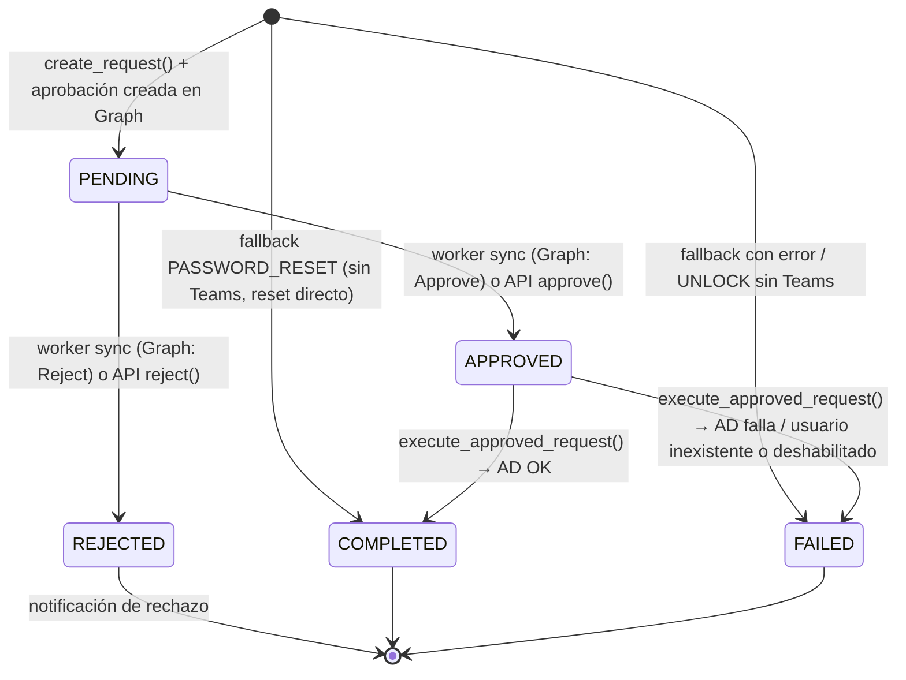

# 02 — Base de datos

**Motor:** SQLite con archivo `ad_support.db` en la raíz del proyecto.
**URL:** `sqlite:///<raíz>/ad_support.db` (`app/db/database.py`).
**Acceso:** SQLAlchemy 2.x con `SessionLocal()` por operación y `check_same_thread=False`.
**Migraciones:** Alembic (cadena verificada con `alembic history`/`current` el 2026-10-09:
la base está en el **head** `fab551fff4d9`).

> SQLite es adecuado para el volumen actual (una instancia, decenas de solicitudes).
> Si se escala a varias instancias o concurrencia alta, migrar a PostgreSQL.

## 1. Tabla `approval_requests` (única tabla de negocio)

DDL real extraído de `ad_support.db`:

```sql
CREATE TABLE approval_requests (
    id                        INTEGER NOT NULL,
    requester_id              VARCHAR(200) NOT NULL,
    ad_username               VARCHAR(100) NOT NULL,
    action                    VARCHAR(50)  NOT NULL,
    status                    VARCHAR(30)  NOT NULL,
    reason                    TEXT,
    approved_by               VARCHAR(200),
    approved_at               DATETIME,
    rejected_by               VARCHAR(200),
    rejected_at               DATETIME,
    completed_at              DATETIME,
    result                    TEXT,
    created_at                DATETIME NOT NULL,
    updated_at                DATETIME NOT NULL,
    graph_approval_id         VARCHAR(100),   -- añadida (migración 5ed15e91cda2)
    approval_comments         TEXT,           -- añadida (migración 25b88d2d28a4)
    conversation_id           VARCHAR(500),   -- añadidas (migración fab551fff4d9)
    conversation_service_url  VARCHAR(500),
    PRIMARY KEY (id)
);
```

### Diccionario de columnas

| Columna | Tipo | Nulo | Significado / regla de negocio |
|---|---|---|---|
| `id` | INTEGER PK | no | Número de solicitud, tal como se informa al usuario (`Número de solicitud: #N`) |
| `requester_id` | VARCHAR(200) | no | AAD object id del solicitante (Teams `from_.aad_object_id`); índice |
| `ad_username` | VARCHAR(100) | no | Usuario de AD sobre el que se actúa; índice; siempre validado `^[a-zA-Z0-9_-]+$` |
| `action` | VARCHAR(50) | no | `PASSWORD_RESET` o `UNLOCK_ACCOUNT` |
| `status` | VARCHAR(30) | no | `PENDING` \| `APPROVED` \| `REJECTED` \| `COMPLETED` \| `FAILED`; índice |
| `reason` | TEXT | sí | Motivo de la solicitud (texto fijo generado por el agente) |
| `approved_by` | VARCHAR(200) | sí | Quién aprobó: OID del aprobador (Teams/Graph) o `username` (API con X-API-Key) |
| `approved_at` | DATETIME | sí | Marca de aprobación (se toma de Graph si está disponible) |
| `rejected_by` | VARCHAR(200) | sí | Quién rechazó |
| `rejected_at` | DATETIME | sí | Marca de rechazo |
| `completed_at` | DATETIME | sí | Fin de la ejecución en AD |
| `result` | TEXT | sí | Texto del resultado (lo que se muestra/consulta; **no** contiene la contraseña temporal) |
| `created_at` | DATETIME | no | Creación (default `datetime.utcnow`); orden del listado `PENDING` |
| `updated_at` | DATETIME | no | `onupdate` automático |
| `graph_approval_id` | VARCHAR(100) | sí | ID del `approvalItem` en Graph; **obligatorio para que el worker procese** la fila; índice |
| `approval_comments` | TEXT | sí | Comentario del aprobador (respuesta de Graph o motivo del rechazo por API) |
| `conversation_id` | VARCHAR(500) | sí | Conversación de Teams para notificar al solicitante |
| `conversation_service_url` | VARCHAR(500) | sí | `service_url` de Teams para enviar la notificación |

**Nota sobre `temp_password`:** la contraseña temporal **no es una columna**. Se entrega en
memoria como atributo transitorio `approval.__dict__["temp_password"]` (solo existe durante
la respuesta que la notifica) y jamás se persiste ni se audita.

### Índices (4)

| Índice | Columna | Por qué |
|---|---|---|
| `ix_approval_requests_requester_id` | `requester_id` | Historial por solicitante / limpieza de tests `test-flow-%` |
| `ix_approval_requests_ad_username` | `ad_username` | Consultas por cuenta AD |
| `ix_approval_requests_status` | `status` | **Filtro del worker** (`status == 'PENDING'`, cada 15 s) |
| `ix_approval_requests_graph_approval_id` | `graph_approval_id` | Localizar la aprobación de Graph |

También existe la tabla `alembic_version` (control de migraciones).

## 2. Máquina de estados



Reglas de transición (fuente: `app/services/approval_service.py`):

- `approve_request` / `reject_request` exigen `status == 'PENDING'` (si no → `ValueError` → HTTP 409).
- `sync_graph_approval` solo consulta Graph si el estado es `PENDING`, `APPROVED` o `REJECTED`;
  cualquier otro estado se devuelve sin tocar.
- `execute_approved_request` exige `status == 'APPROVED'` (si no → HTTP 409).

## 3. Distribución actual de datos (2026-10-13)

| status | action | filas |
|---|---|---|
| COMPLETED | UNLOCK_ACCOUNT | 15 |
| COMPLETED | PASSWORD_RESET | 6 |
| FAILED | UNLOCK_ACCOUNT | 4 |
| REJECTED | UNLOCK_ACCOUNT | 3 |
| APPROVED | UNLOCK_ACCOUNT | 2 *(filas históricas de pruebas antiguas, sin ejecutar)* |
| **Total** | | **30** |

> Las 2 filas `APPROVED` sin ejecutar son el único estado "colgado" posible: el worker no
> las retoma (solo procesa `PENDING`). Ver runbook 5.2 en
> [05-configuracion-y-operacion.md](05-configuracion-y-operacion.md).

## 4. Migraciones Alembic

Cadena completa (verificada con `alembic history`):

```
<base> ──▶ 4d1e5b808835 ──▶ 5ed15e91cda2 ──▶ 25b88d2d28a4 ──▶ fab551fff4d9 (head, actual)
          create_approval  add_graph_       add_approval_     add_conversation_id
          _requests        approval_id      comments          + _service_url
          (+ 3 índices)    (+ 1 índice)                         (batch mode)
```

| Revisión | Cambio |
|---|---|
| `4d1e5b808835` | `create_table approval_requests` + índices `ad_username`, `requester_id`, `status` |
| `5ed15e91cda2` | `add_column graph_approval_id` + índice |
| `25b88d2d28a4` | `add_column approval_comments` |
| `fab551fff4d9` | `add_column conversation_id`, `conversation_service_url` (batch, necesario en SQLite) |

### Comandos

```powershell
.venv\Scripts\python.exe -m alembic history          # cadena
.venv\Scripts\python.exe -m alembic current          # revisión actual
.venv\Scripts\python.exe -m alembic upgrade head     # aplicar todo
.venv\Scripts\python.exe -m alembic revision --autogenerate -m "descripcion"
```

> `alembic/env.py` importa `app.models.approval_request` para registrar la tabla en
> `Base.metadata` (necesario para el autogenerate).

## 5. Copias de seguridad

- El archivo es un solo `.db`: copiar el archivo detenido o con `sqlite3 ad_support.db ".backup out.db"`.
- `logs/audit.jsonl` complementa la BD con el historial de eventos de la conversación.
