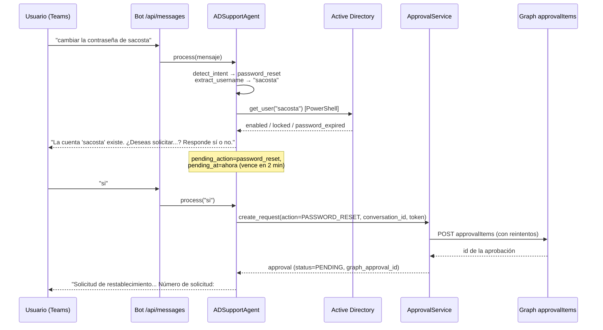
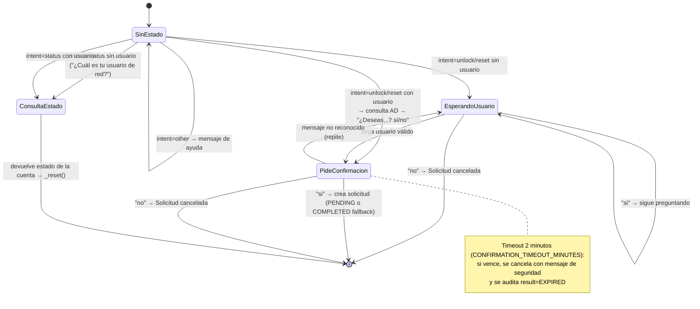
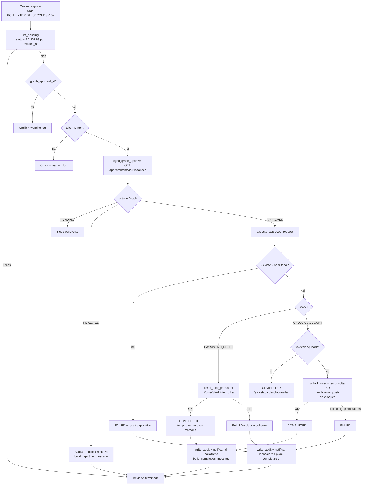
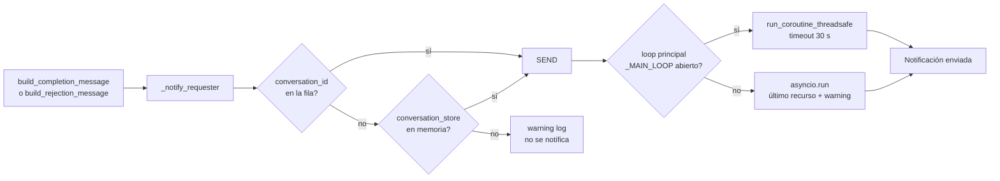
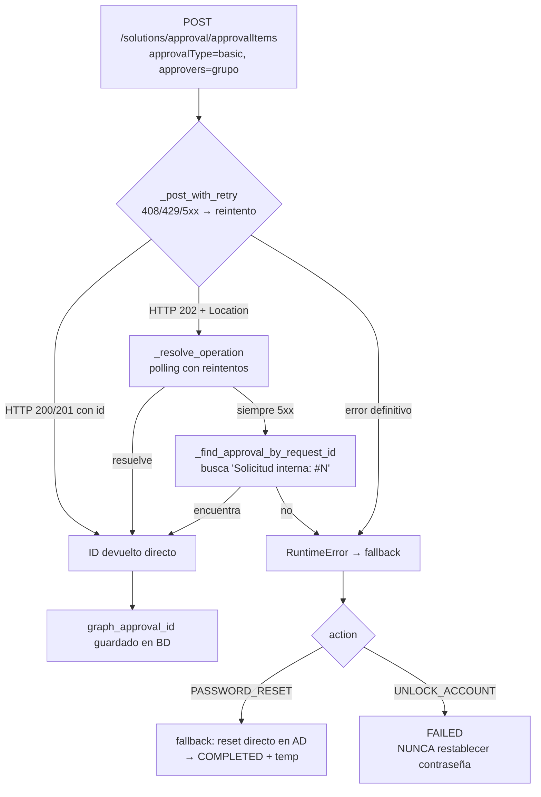

# 03 — Flujos de funcionamiento

Todos los diagramas son Mermaid (se renderizan en GitHub/VS Code).

## 1. Flujo de conversación en Teams



Si el usuario **no** envía el usuario en el mismo mensaje, el agente pregunta
`"¿Cuál es tu usuario de red?"` y espera ese dato (estado `pending_action` sin
`pending_username`). Ver [04-reglas-negocio.md](04-reglas-negocio.md).

## 2. Estados de la conversación (agente)



## 3. Aprobación y worker (cada 15 s)



Puntos clave:

- El worker **solo** procesa `PENDING` con `graph_approval_id` y token Graph disponibles.
- `asyncio.to_thread` evita bloquear el loop mientras corre el proceso síncrono.
- Una excepción por solicitud **no detiene** el ciclo: se loguea y sigue con la siguiente.

## 4. Notificación al solicitante



Detalles importantes (fuente: `app/services/approval_worker.py`):

- El worker y las APIs corren en el **mismo proceso** que el servidor; el loop real se
  resuelve desde `sys.modules["__main__"]` cuando el servicio arranca con
  `python -m app.main` (por eso **hay que usar `-m`**; un import normal crearia un segundo
  módulo con `_MAIN_LOOP=None` y caería al fallback `asyncio.run`).
- Las APIs envuelven la notificación en `try/except`: **un fallo de Teams nunca bloquea
  la API** (regresión cubierta por `tests/test_api_approvals.py`).
- Mensajes: `build_completion_message` incluye `Contraseña temporal: X. Debe cambiarla al
  iniciar sesión.` solo si `action=PASSWORD_RESET` **y** `status=COMPLETED` **y** hay
  `temp_password`; `build_rejection_message` indica tipo de solicitud y motivo.

## 5. Creación de la aprobación en Graph (resiliencia)



## 6. Flujo completo del reset de contraseña (resumen)

```
1. Mensaje → intención + usuario extraído
2. Consulta AD (PowerShell) → cuenta habilitada/estado
3. Confirmación "sí" (o timeout 2 min → cancela)
4. create_request → fila PENDING en BD
5. Aprobación en Teams/Graph (con reintentos) → graph_approval_id
6. (Si falla Teams) fallback: reset directo → COMPLETED + notificación inmediata
7. Aprobador acciona en Teams (tarjeta de aprobación de Graph)
8. Worker (≤15 s) detecta APPROVED → ejecuta reset en AD
      • contraseña temporal fija `Temporal$2026*`
      • ChangePasswordAtLogon = true (cambio obligatorio al primer inicio)
9. write_audit + mensaje en Teams: resultado + contraseña temporal + "debe cambiarla"
```
